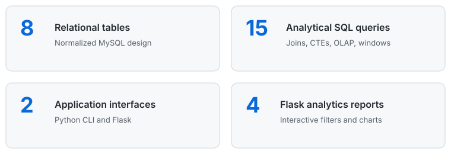
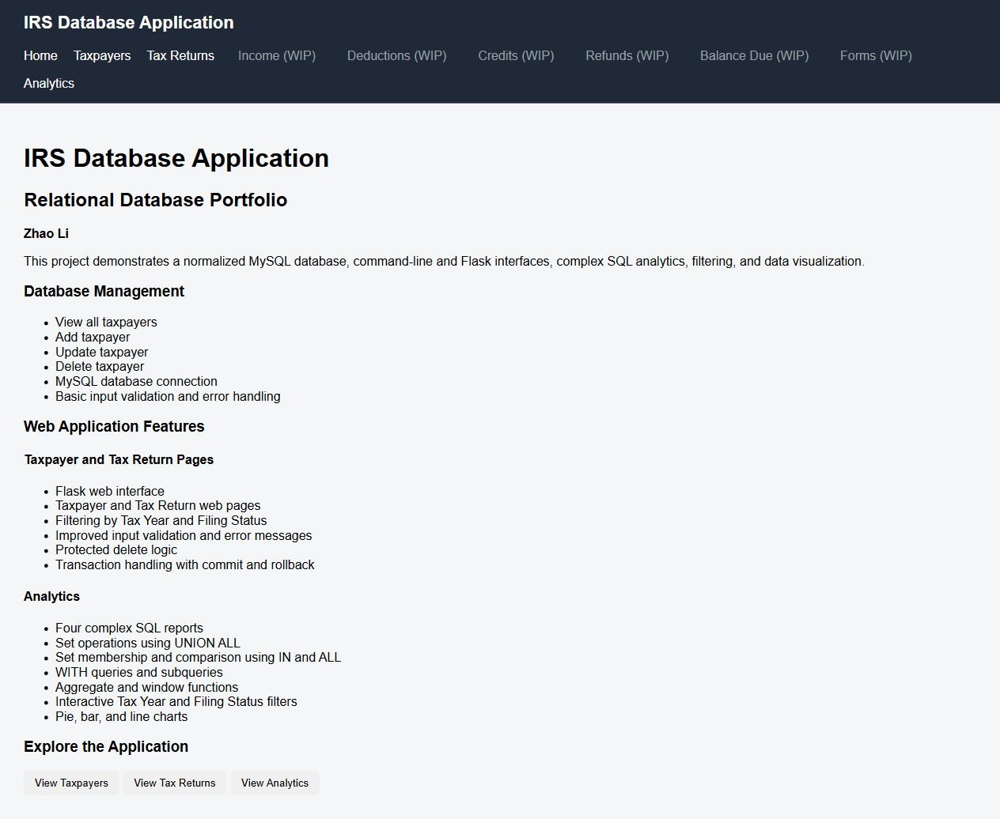
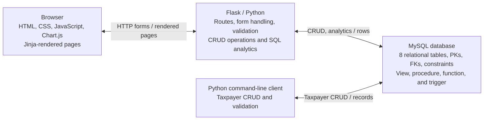

# IRS-Inspired Synthetic Tax Database Application

A portfolio project that models high-level Form 1040 concepts with synthetic data, an eight-table MySQL database, Python command-line and Flask web applications, advanced SQL analytics, and interactive Chart.js visualizations.

> This is an educational prototype. It is not affiliated with the IRS and must not be used with real taxpayer information.

## Project Highlights



The project progresses from relational modeling and synthetic data generation to database implementation, analytical SQL, a command-line client, and a browser-based application.

## Application Preview

### Portfolio homepage



### Tax-return management


### Interactive SQL analytics


Additional interface and validation captures are available in [`screenshots/`](screenshots/).

## System Architecture



The browser communicates with Flask, which validates input and queries MySQL. The separate Python CLI is another database client. See the [database design and ERD](docs/database-design.md) for table-level relationships.

## Key Features

- Normalized design with eight related tables, primary keys, foreign keys, and financial-value checks.
- Synthetic CSV data and repeatable Python data generators.
- Taxpayer CRUD in both the Python CLI and Flask application.
- TaxReturn CRUD, filtering, confirmation pages, and protected deletes in Flask.
- Parameterized SQL, explicit commits and rollbacks, and form-data preservation after validation errors.
- Fifteen documented SQL analyses using joins, aggregates, CTEs, grouping operations, and window functions.
- Four filterable Flask reports with tables and pie, bar, or line charts.

CRUD is implemented for `Taxpayer` and `TaxReturn`, not for all eight database tables.

## Analytics Examples

| Business question | SQL concepts |
|---|---|
| What are the refund and balance-due outcomes? | `UNION ALL` |
| Which returns have the highest deductions within each filing status? | `IN`, `ALL` |
| How do refunds compare across deduction quartiles? | CTE, `NTILE`, windowed `AVG`, `RANK` |
| How does income accumulate over filing dates? | Windowed `AVG`, `SUM`, `COUNT` |

The full collection is in [`analytics/analytical_queries.sql`](analytics/analytical_queries.sql), with questions and findings in the [analytics guide](analytics/query-guide.md).

## Technology Stack

| Layer | Technologies |
|---|---|
| Database | MySQL 8.0, SQL |
| Backend | Python, Flask, MySQL Connector/Python |
| Frontend | Jinja, HTML, CSS, JavaScript, Chart.js |
| CLI and data generation | Python, `tabulate`, Faker, `csv`, `random`, `datetime` |

Exact dependency versions were not preserved, so `requirements.txt` intentionally lists packages without invented version pins.

## Quick Start

Prerequisites are Python 3, MySQL 8.0 or later, and a MySQL account that can create a database.

```powershell
python -m venv .venv
.\.venv\Scripts\Activate.ps1
python -m pip install -r requirements.txt
```

Open this repository as a folder in VS Code and launch MySQL from the repository root so its relative paths resolve correctly:

```powershell
mysql --local-infile=1 -u root -p
```

Inside the MySQL client, run:

```sql
SOURCE database/01_schema.sql
SOURCE database/02_load_seed_data.sql
SOURCE database/03_database_features.sql
```

Set `MYSQL_PASSWORD` and the optional connection variables described in `.env.example`, then start either interface:

```powershell
python web/app.py
python cli/irs_cli.py
```

See the [complete setup guide](docs/setup-guide.md) for environment variables, expected seed counts, and troubleshooting.

## Dataset and Scope

- All included records are synthetic.
- The packaged seed contains 25 taxpayers and 25 tax returns for 2025.
- The later reviewed working database contained 35 returns after 10 records for 2023 were added in SQL.
- The additional 10 rows were not exported back into the packaged CSV seed.
- Fresh CSV loading and complete database reproduction from scratch remain unverified.

Some conceptual rules are only partially enforced. For example, the database blocks a `BalanceDue` insert when a refund exists, but does not implement the reciprocal trigger on `Refund` or unique outcome constraints.

## Documentation

- [Setup guide](docs/setup-guide.md)
- [Project overview and development progression](docs/Project-Overview.md)
- [Technical learning summary](docs/Technical-Learning-Summary.md)
- [Database design and ERD](docs/database-design.md)
- [Database setup notes](database/README.md)
- [Analytics questions and findings](analytics/query-guide.md)

## Future Development

A reusable relational-database development SKILL is planned as a future extension. It is currently a work in progress and has not been implemented. See [`skills/README.md`](skills/README.md) for its proposed scope.
