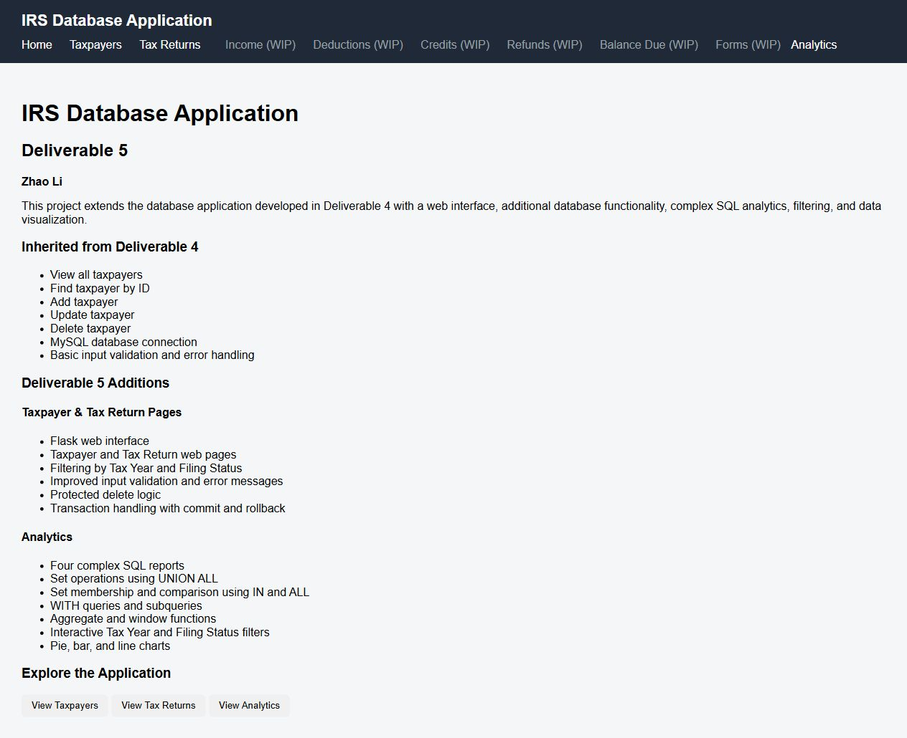
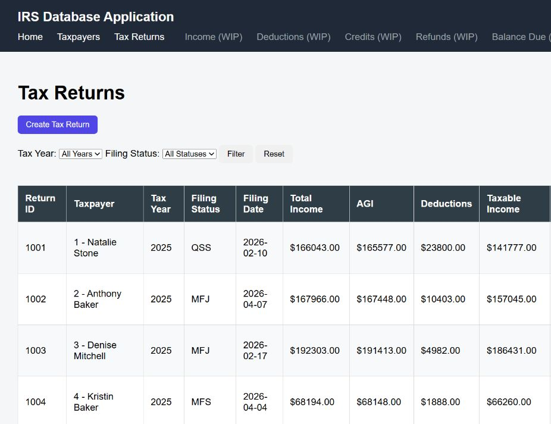
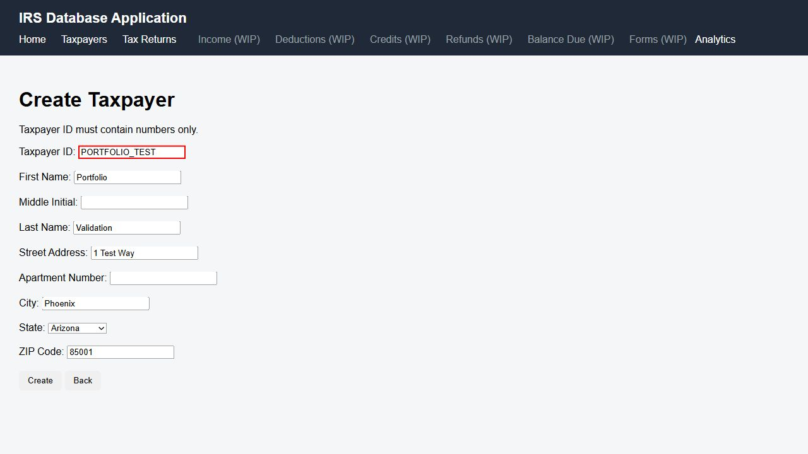
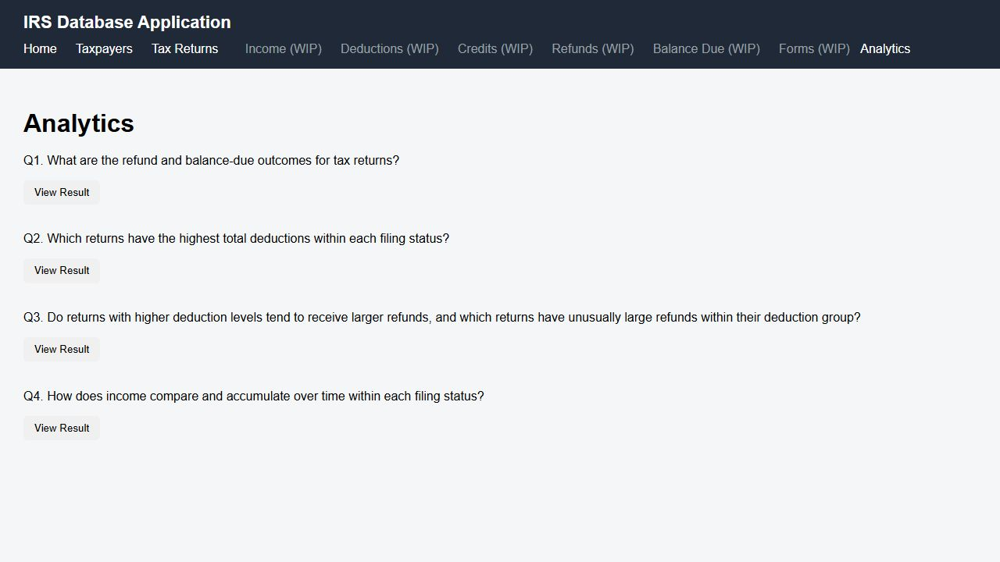
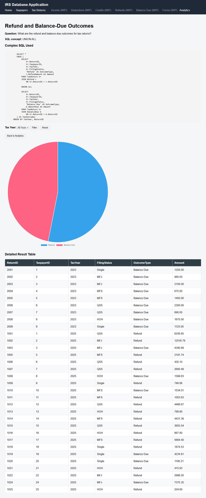
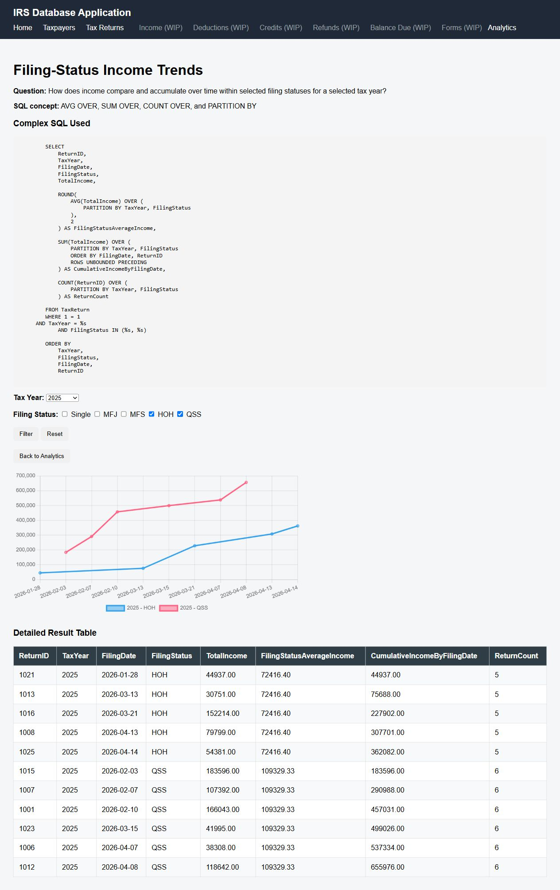

# IRS-Inspired Relational Database and Analytics Application

An educational portfolio project that models high-level individual tax-return data in MySQL and makes it accessible through SQL analysis, a Python command-line interface, and a Flask web application. The project uses synthetic data and is not affiliated with, connected to, or intended for use by the Internal Revenue Service.

## Project Overview

The application connects taxpayers to tax returns, income records, deductions, credits, forms, refunds, and balances due. It was developed to demonstrate relational design, database constraints, analytical SQL, safe parameterized application queries, transaction handling, form validation, and data visualization.

The main questions include:

- How do income, deductions, credits, and tax outcomes differ by filing status?
- Which returns rank highest within a group?
- How do refunds compare across deduction quartiles?
- How does income accumulate over filing dates and tax years?

## Technology Stack

- MySQL 8.0 and SQL
- Python
- Flask and Jinja templates
- MySQL Connector/Python
- HTML and CSS
- JavaScript and Chart.js
- `tabulate` for command-line tables

Package versions are intentionally not pinned because exact installed versions were not preserved in the coursework.

## Database Architecture

The normalized design contains eight related tables:

| Table | Purpose |
|---|---|
| `Taxpayer` | Names and address information |
| `TaxReturn` | Filing status, dates, income, deductions, credits, and tax totals |
| `IncomeRecord` | Itemized income sources |
| `Deduction` | Itemized deductions |
| `TaxCredit` | Itemized credits |
| `Refund` | Refund amount, date, and status |
| `BalanceDue` | Amount owed, due date, and status |
| `TaxForm` | Forms and schedules associated with a return |

`Taxpayer` has a one-to-many relationship with `TaxReturn`. Each of the other six detail tables references `TaxReturn`. Primary keys, foreign keys, allowed filing statuses, and nonnegative financial amounts are enforced in the schema. The complete ERD and design rationale are in [docs/database-design.md](docs/database-design.md).

Some conceptual rules are only partially enforced. In particular, the trigger prevents a `BalanceDue` insert when a refund exists, but there is no reciprocal trigger on `Refund`. The intended maximum of one refund or balance-due record per return is also not backed by a unique constraint.

## Development Progression

1. Designed the problem domain, users, use cases, ERD, and relational schemas.
2. Implemented eight MySQL tables, constraints, synthetic seed data, a view, stored procedure, function, and trigger.
3. Built 15 analytical SQL queries using joins, subqueries, aggregates, grouping sets, common table expressions, and window functions.
4. Added a Python command-line CRUD interface for taxpayer records.
5. Added a Flask interface with taxpayer and tax-return CRUD, filtering, validation, protected deletes, and four interactive analytics reports.

## Application Features

- List, create, edit, and delete taxpayers and tax returns.
- Parameterized SQL queries for user-supplied values.
- Duplicate-ID, ZIP-code, filing-status, required-field, and financial-value validation.
- Form-value preservation after validation errors.
- Delete confirmation pages and relationship checks that protect referenced records.
- Tax-return filtering by tax year and filing status.
- Explicit commits and rollbacks around data changes.

CRUD coverage is limited to `Taxpayer` and `TaxReturn`; the other six tables are available through the database and analytical queries.

## SQL Analytics

[analytics/analytical_queries.sql](analytics/analytical_queries.sql) contains 15 documented analyses. Representative examples include:

- Ranking the highest-income return within each filing status.
- Comparing each return with the overall income distribution.
- Calculating cumulative income by filing status and filing date.
- Using grouping sets to compare state, tax-year, and income-type aggregates.
- Dividing returns into deduction quartiles and ranking refunds within each group.

See [analytics/query-guide.md](analytics/query-guide.md) for the business questions, findings, and original result captures.

## Flask Analytics

The web application turns four SQL analyses into filterable reports with result tables and Chart.js visualizations:

1. Refund versus balance-due outcomes using `UNION ALL`.
2. Highest deductions by filing status using `IN` and `ALL`.
3. Refunds by deduction quartile using a CTE, `NTILE`, windowed `AVG`, and `RANK`.
4. Filing-status income trends using windowed `AVG`, cumulative `SUM`, and `COUNT`.

## Screenshots

### Homepage and navigation



### Tax-return management



### Input validation



### Analytics dashboard



### Refund and balance-due analysis



### Filing-status income trends



All displayed data is synthetic. The screenshots were captured from the final running coursework application before the public-copy wording and configuration cleanup.

## Local Setup

### Prerequisites

- Python 3
- MySQL 8.0 or later
- A MySQL account allowed to create the `irs_project_db` database
- MySQL local data loading enabled

### 1. Install Python dependencies

```powershell
python -m venv .venv
.\.venv\Scripts\Activate.ps1
python -m pip install -r requirements.txt
```

### 2. Build the database

In VS Code, choose **File > Open Folder** and select the `GitHub-Portfolio` folder. Then choose **Terminal > New Terminal**. The terminal must be in the repository root before MySQL starts because both `SOURCE` and `LOAD DATA LOCAL INFILE` resolve these relative paths from the MySQL client's launch directory.

Confirm the terminal location and schema path:

```powershell
Get-Location
Test-Path .\database\01_schema.sql
```

`Get-Location` should end with `GitHub-Portfolio`, and `Test-Path` should return `True`. If needed, change to the repository root first:

```powershell
Set-Location -LiteralPath "C:\path\to\GitHub-Portfolio"
```

From that same terminal, start the MySQL client with local file loading enabled:

```powershell
mysql --local-infile=1 -u root -p
```

Then run these commands inside the MySQL client:

```sql
SOURCE database/01_schema.sql
SOURCE database/02_load_seed_data.sql
SOURCE database/03_database_features.sql
```

Forward slashes are intentional and work with the MySQL client on Windows. If the client was launched from another directory, exit with `quit`, return to the repository root in PowerShell, and launch it again.

The included CSV files recreate the verified 25-return seed. The final working database was expanded to 35 returns through later SQL, but those 10 additional rows were not exported back to the submitted CSV files. See [database/README.md](database/README.md) for expected table counts and this reproducibility boundary.

Manual testing confirmed that the clean schema logic creates all eight tables in a separate test database. Fresh execution of the CSV loader and `03_database_features.sql` was not completed, so complete recreation from scratch remains unverified.

### 3. Configure the database connection

Set the password in the current PowerShell session. Change the other values only if your MySQL setup differs:

```powershell
$env:MYSQL_PASSWORD = "your_local_password"
$env:DB_HOST = "localhost"
$env:DB_USER = "root"
$env:DB_NAME = "irs_project_db"
```

`.env.example` documents the supported variables. The application reads process environment variables directly and does not automatically load a `.env` file.

### 4. Run the Flask application

```powershell
python web/app.py
```

Open `http://127.0.0.1:5000`.

### 5. Run the command-line application

```powershell
python cli/irs_cli.py
```

## Synthetic Data

The seed CSV files are in `database/data/`, and the Python generators used during development are in `database/generators/`. Names, addresses, and financial values are generated test data. Because generated personal-style values can coincidentally resemble real information, they must not be treated as real taxpayer records.

## Limitations and Future Improvements

Current limitations include partially enforced cross-table business rules, inconsistent state validation between existing seed data and the web forms, CRUD coverage for only two tables, unpinned dependency versions, and a clean seed that recreates 25 rather than the later 35 tax returns.

Optional improvements include reciprocal database triggers or stronger constraints, shared validation logic, automated tests, database migrations, dependency lock files, CSRF protection and production deployment settings, pagination, expanded CRUD coverage, and improved responsive table layouts. These are portfolio enhancements, not claims about course requirements.

## Repository Map

```text
analytics/                 15 analytical queries, guide, selected results
cli/                       Python command-line CRUD application
database/                  schema, seed loader, database objects, data generators
docs/                      project overview, learning summary, ERD and design notes
screenshots/               selected live application captures
web/                       Flask backend, templates, and CSS
```

## Documentation

- [Project overview](docs/Project-Overview.md)
- [Technical learning summary](docs/Technical-Learning-Summary.md)
- [Database design and ERD](docs/database-design.md)
