# Analytical SQL Query Guide

## Overview

- Uses the fictional IRS-inspired MySQL database included in this repository.
- Contains 15 SQL queries using joins, aggregation, window functions, and OLAP analysis.
- Uses synthetic tax data.

## Files

- `analytical_queries.sql` - SQL queries
- `query-results/` - Query output screenshots

## Query Results and Findings

### Query 1: Does higher total income also mean higher taxable income?
**Answer:** The rankings are generally similar, but not identical. Higher total income does not always result in a higher taxable income ranking.
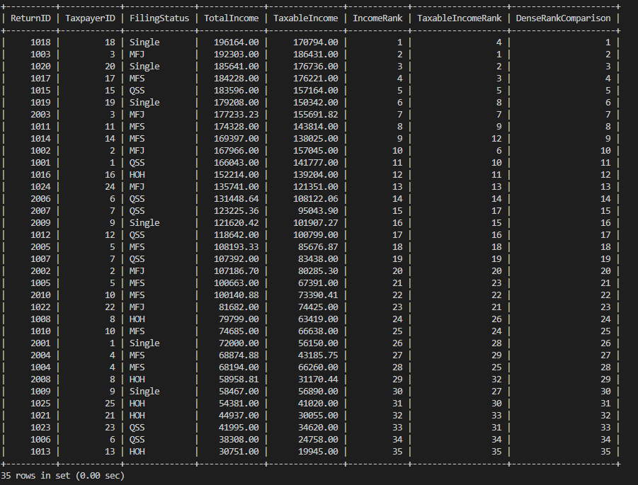

### Query 2: Which tax returns have the highest total income within each filing status?
**Answer:** Income rankings reset within each filing status, showing the highest-income returns separately for HOH, MFJ, MFS, QSS, and Single filers.
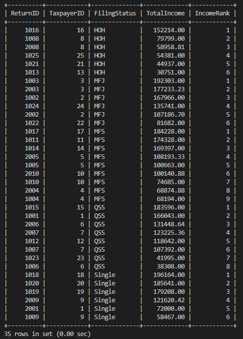

### Query 3: Which tax returns fall toward the lower, middle, or higher end of the income distribution?
**Answer:** The percent rank shows each return's position in the income distribution, ranging from 0% for the lowest-income return to 100% for the highest-income return.
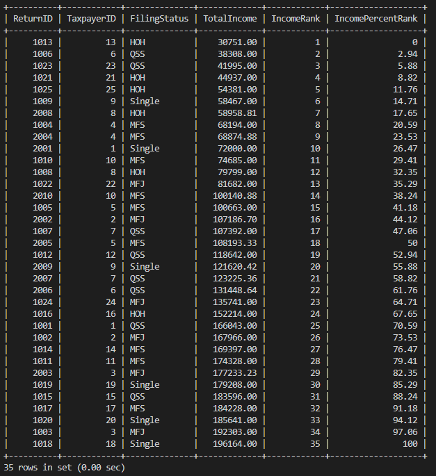

### Query 4: How does each tax return's total income compare with the overall income distribution?
**Answer:** Percent rank shows each return's relative position, while cumulative distribution shows the percentage of returns with income at or below that return.
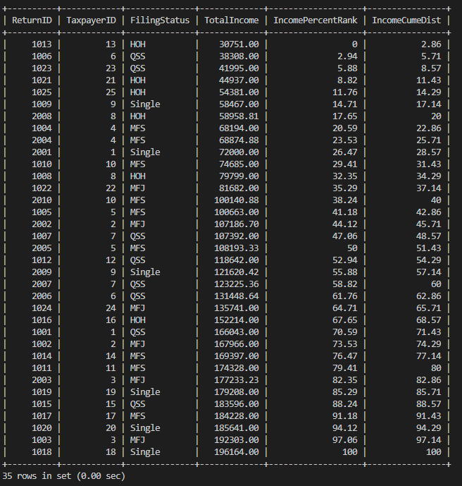

### Query 5: How can tax returns be divided into four groups based on total income?
**Answer:** The 35 tax returns are divided into four income quartiles, from the lowest-income group (1) to the highest-income group (4).
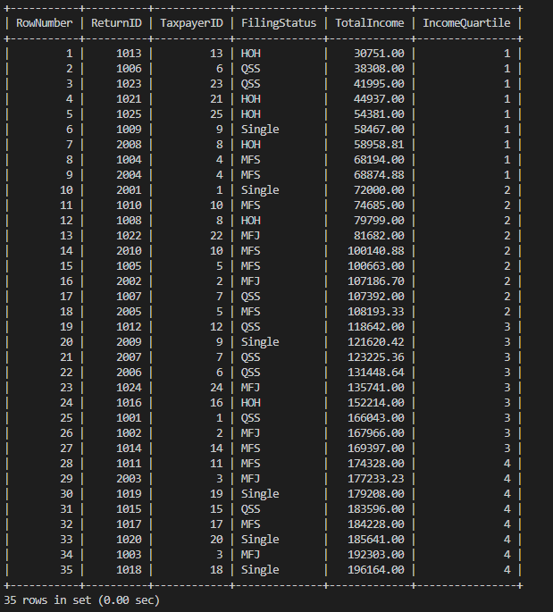

### Query 6: How does cumulative total income grow over time within each filing status?
**Answer:** Total income accumulates over filing dates within each filing status, with the running total restarting for each filing status.
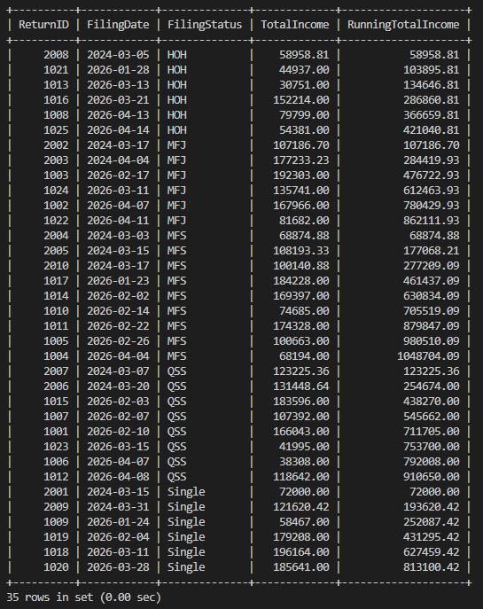

### Query 7: How does each return's total income compare with the average of nearby filed returns within the same filing status?
**Answer:** The moving average compares each return's income with nearby returns by filing date within the same filing status, helping show changes in income over time.
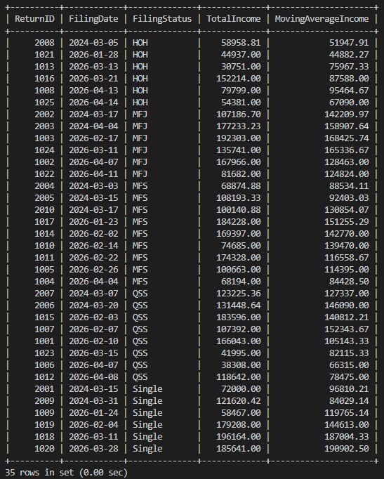

### Query 8: How do the number of tax returns and average total income differ across filing statuses?
**Answer:** MFJ has the highest average income at $143,685.32, while HOH has the lowest at $70,173.47. MFS has the most returns with 9.

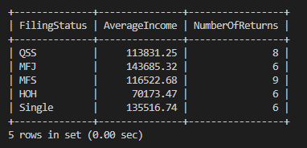

### Query 9: How does the average total income for each filing status compare with the overall average total income?
**Answer:** MFJ has the highest average income at $143,685.32, while HOH has the lowest at $70,173.47. The overall average income is $115,874.49.

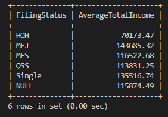

### Query 10: How does total income differ by filing status and income type?
**Answer:** Total income varies by both filing status and income type. Wages make up the largest total for several filing statuses, while rental, interest, dividend, and business income vary across groups.
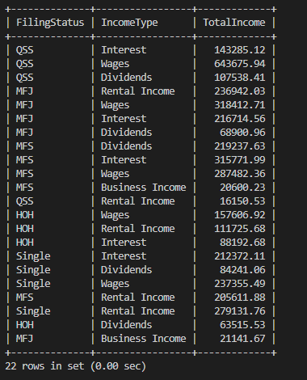

### Query 11: How does average income differ by tax year, taxpayer state, and income type?
**Answer:** Average income varies across tax years, states, and income types, showing how income can be analyzed from multiple dimensions.
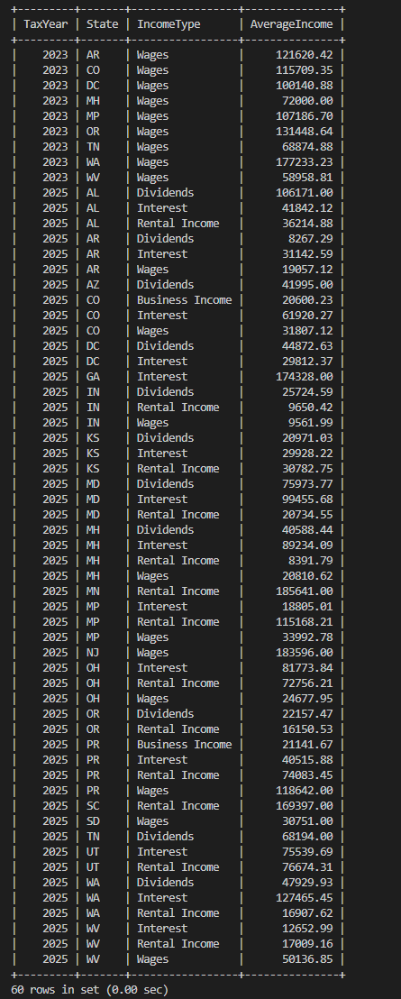

### Query 12: How does the average number of income types differ by tax outcome and filing status?
**Answer:** Refund returns generally have more income types on average than balance-due returns, although the pattern varies by filing status.
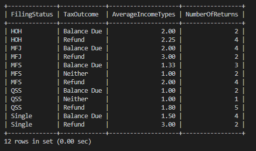

### Query 13: How do average income, deductions, and tax credits differ across filing statuses?
**Answer:** MFJ has the highest average income, while QSS has the highest average deductions and credits. The results show that income, deductions, and credits vary across filing statuses.
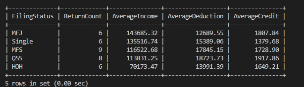

### Query 14: How do average income, deductions, credits, and refund amounts compare across filing statuses for returns receiving refunds?
**Answer:** MFJ has the highest average refund at $7,757.65, while HOH has the lowest at $572.03. Average income, deductions, credits, and refunds vary considerably across filing statuses.
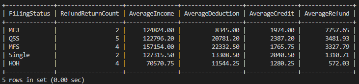

### Query 15: How do refund amounts compare across deduction levels, and which returns have the largest refunds within each deduction group?
**Answer:** Refund amounts do not consistently increase with deduction levels. The lowest deduction quartile has the highest average refund ($4,549.27), while the second quartile has the lowest ($479.61).
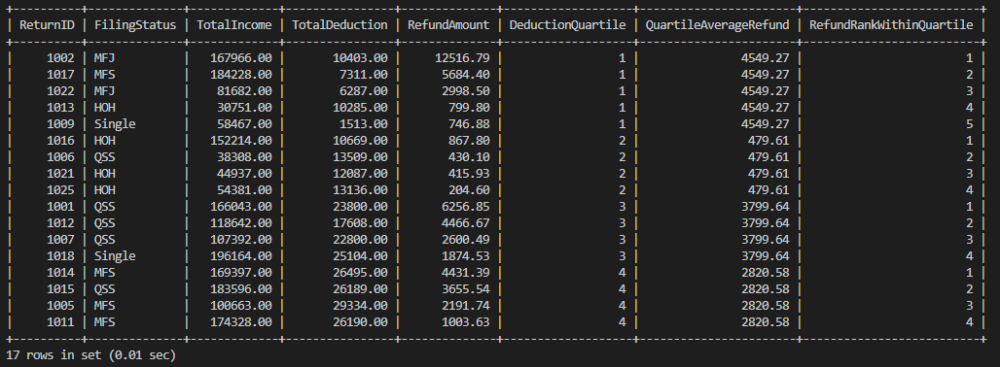
